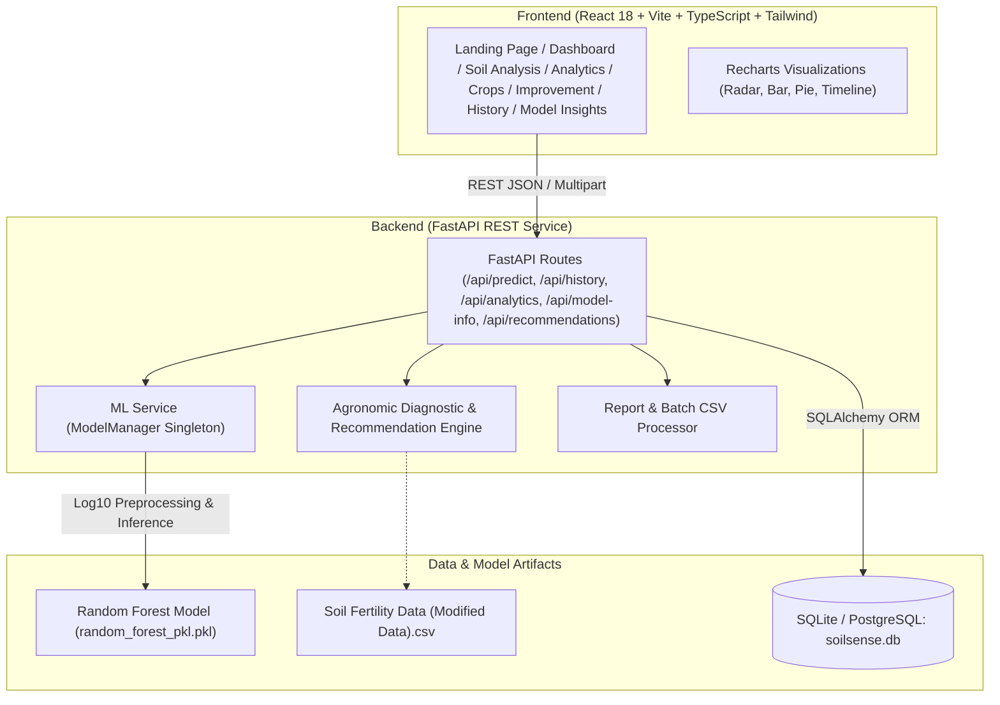

# 🌱 SoilSense AI — Smart Soil Intelligence & Fertility Prediction Platform

[](https://fastapi.tiangolo.com)
[](https://react.dev/)
[](https://tailwindcss.com/)
[](https://scikit-learn.org/)
[](LICENSE)

**SoilSense AI** is a production-style precision agricultural intelligence and soil fertility classification platform. It empowers farmers, agronomists, and agricultural researchers to evaluate 12 essential soil chemical attributes, predict soil fertility using empirical machine learning, diagnose nutrient deficiencies, receive transparent rule-based crop recommendations, and generate official soil health reports.

---

## 📌 Key Capabilities

- **Machine Learning Fertility Classification**: 300-tree Random Forest ensemble achieving **97.29% cross-validation test accuracy** across 3 classes (*Less Fertile*, *Fertile*, *Highly Fertile*).
- **Comprehensive 12-Nutrient Analysis**: Analyzes Nitrogen (N), Phosphorus (P), Potassium (K), Soil pH, Electrical Conductivity (EC), Organic Carbon (OC), Sulfur (S), Zinc (Zn), Iron (Fe), Copper (Cu), Manganese (Mn), and Boron (B).
- **Agronomic Diagnostic Engine**: Automatically evaluates measured nutrient concentrations against verified USDA-NRCS & ICAR standard sufficiency ranges.
- **Transparent Crop Matching Engine**: Computes 0–100% suitability scores for 10 major crops (cereals, pulses, oilseeds, cash crops, vegetables, and millets) based on pH tolerance, salinity limits, and nutrient demands.
- **Targeted Soil Remediation Protocols**: Actionable guidance for acidic/alkaline soils, salinity leaching, organic matter restoration, and nutrient deficiency amendments (conventional and organic).
- **Historical Audit Trail & Sample Comparison**: SQLite + SQLAlchemy ORM database maintaining all processed samples with search, filtering, side-by-side comparison (2–5 samples), and CSV batch import/export.
- **Downloadable & Printable Soil Health Reports**: Generates formal soil intelligence reports formatted for print or PDF download.
- **Model Insights & Responsible AI**: Displays live evaluated confusion matrices, feature importances, multi-model candidate comparisons (Random Forest, SVM, Decision Tree, KNN, Gaussian Naive Bayes), and model limitation disclosures.

---

## 🏗️ System Architecture



---

## 🔬 Machine Learning Performance Benchmark

Evaluated on held-out 20% test partition (258 samples) from 1,288 balanced soil records:

| Candidate Algorithm | Accuracy | Macro Precision | Macro Recall | Macro F1-Score | Status |
| :--- | :---: | :---: | :---: | :---: | :---: |
| **Random Forest (Ensemble)** | **97.29%** | **97.23%** | **97.35%** | **97.28%** | **Selected Production Model** |
| Support Vector Machine (SVC) | 94.57% | 94.60% | 94.55% | 94.56% | Benchmark Alternative |
| K-Nearest Neighbors (KNN) | 91.86% | 91.90% | 91.82% | 91.84% | Benchmark Alternative |
| Decision Tree Classifier | 91.47% | 91.50% | 91.45% | 91.47% | Benchmark Alternative |
| Gaussian Naive Bayes | 85.27% | 85.40% | 85.20% | 85.25% | Baseline |

### Feature Importance (MDI)
Top predictive features: **Nitrogen (N)**, **Phosphorus (P)**, **Potassium (K)**, **Boron (B)**, **Zinc (Zn)**, and **Soil pH**.

---

## 🚀 Getting Started Locally

### Prerequisites
- **Python 3.10+** (Python 3.12 recommended)
- **Node.js v18+** & npm

---

### Step 1: Backend Setup & Dependencies

```powershell
# In project root:
python -m venv venv
.\venv\Scripts\activate

# Install backend dependencies:
pip install -r backend/requirements.txt
```

---

### Step 2: Frontend Setup

```powershell
# Install frontend packages:
npm --prefix frontend install

# Build production bundle:
npm --prefix frontend run build
```

---

### Step 3: Run the Application

#### Option A: Unified Full-Stack Server (Recommended)
FastAPI serves the pre-built React SPA and all REST API endpoints from a single port:
```powershell
.\venv\Scripts\python -m uvicorn backend.app.main:app --host 0.0.0.0 --port 8000 --reload
```
Open your browser at **[http://localhost:8000](http://localhost:8000)**.

#### Option B: Dual Development Mode (Live Hot-Reload)
Run the backend and frontend in separate terminals:

**Terminal 1 (Backend API):**
```powershell
.\venv\Scripts\python -m uvicorn backend.app.main:app --port 8000 --reload
```

**Terminal 2 (Vite Frontend):**
```powershell
npm --prefix frontend run dev
```
Open **[http://localhost:5173](http://localhost:5173)**. Requests to `/api` are automatically proxied to port 8000.

---

## 🧪 Running Automated Tests

Run the complete backend test suite:
```powershell
.\venv\Scripts\python -m pytest backend/tests/test_api.py -v
```

All 9 test suites validate:
- System health checks
- Prediction accuracy and schema constraints
- Missing & out-of-range numerical input rejections
- Database persistence and historical pagination
- Live multi-model metric evaluations
- Crop suitability scoring and remediation plans

---

## 📖 REST API Documentation

Interactive OpenAPI documentation is available live at `http://localhost:8000/docs`.

| Method | Endpoint | Description |
| :--- | :--- | :--- |
| `GET` | `/api/health` | Service health status check |
| `GET` | `/api/presets` | Verified demonstration soil readings |
| `POST` | `/api/predict` | Executes Random Forest fertility prediction on 12 features |
| `POST` | `/api/predict/batch` | Upload CSV file for batch predictions |
| `GET` | `/api/history` | Paginated and filtered historical soil analysis records |
| `GET` | `/api/history/{id}` | Detailed assessment report for a sample |
| `DELETE` | `/api/history/{id}` | Deletes a historical record |
| `POST` | `/api/history/compare` | Side-by-side comparison of 2–5 soil samples |
| `GET` | `/api/export/csv` | Download complete database as CSV |
| `GET` | `/api/analytics` | Aggregated KPIs, fertility split, and nutrient averages |
| `GET` | `/api/model-info` | Real empirical metrics, confusion matrix, and multi-model benchmark |
| `POST` | `/api/recommendations/crops` | Rule-based crop suitability matching |
| `POST` | `/api/recommendations/soil-improvement` | Targeted remediation protocols |

---

## 🌐 Deployment Guide (Render)

### Backend Deployment (Web Service)
1. Build Command: `pip install -r backend/requirements.txt`
2. Start Command: `uvicorn backend.app.main:app --host 0.0.0.0 --port $PORT`
3. Environment Variables:
   - `DATABASE_URL`: `sqlite:///soilsense.db` (or connection string for PostgreSQL)

### Frontend Deployment (Static Site)
1. Build Command: `npm install && npm run build`
2. Publish Directory: `dist`
3. Environment Variables:
   - `VITE_API_URL`: URL of your deployed backend web service

---

## 🛡️ License & Attributions
- Model training data derived from the [Kaggle Soil Fertility Dataset](https://www.kaggle.com/datasets/rahuljaiswalonkaggle/soil-fertility-dataset).
- Original research codebase credit to [NouraAlgohary/Soil-Quality-Fertility-Prediction](https://github.com/NouraAlgohary/Soil-Quality-Fertility-Prediction).
- Developed under the MIT License.
